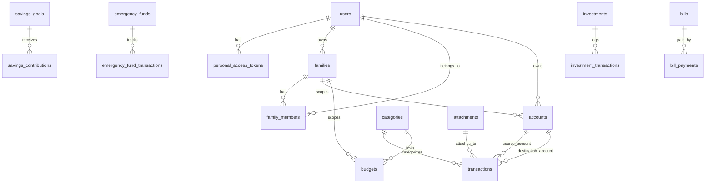

# Entity Relationship Diagram (ERD) — Family Finance MySQL 8

## Diagram Relasi Antartabel

## Ringkasan Integritas Data

1. **Presisi Nominal Keuangan**: Seluruh nominal mata uang IDR memakai `DECIMAL(20,2)` (bukan `FLOAT`/`DOUBLE`). Unit emas digital & instrumen investasi memakai `DECIMAL(16,4)`.
2. **Isolasi Ruang Keuangan & Privasi**: Setiap tabel keuangan memiliki `user_id`, `family_id`, dan enum `space` (`pribadi`, `keluarga`, `anak`). Data berspace `pribadi` terkunci oleh `FinancialRecordPolicy` sehingga tidak terlihat oleh anggota lain tanpa izin eksplisit.
3. **Konsistensi Saldo & Idempotency**: Tabel `transactions` memiliki `UNIQUE (user_id, idempotency_key)` untuk mencegah duplikasi request jaringan, serta `softDeletes()` agar penghapusan tetap dapat diaudit dan saldo akun dihitung ulang secara atomik di dalam `DB::transaction()`.
4. **Pemisahan Transfer & Alokasi Aset**: Transaksi `transfer` dan transaksi dengan `is_asset_allocation = true` (setoran tabungan, dana darurat, pembelian investasi) mengubah saldo akun secara akurat namun dikecualikan dari laporan pemasukan/pengeluaran konsumtif.
